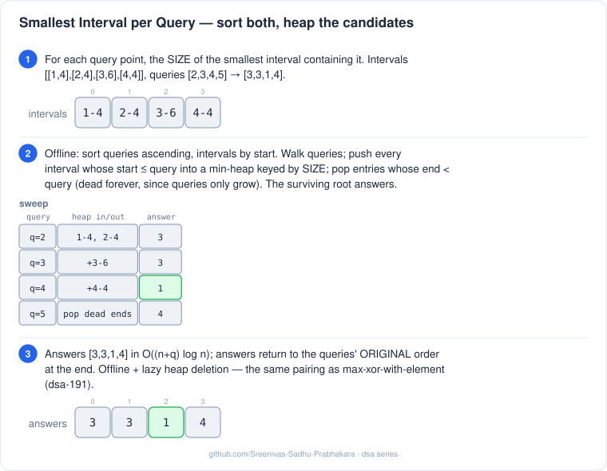

# Minimum Interval to Include Each Query

> NeetCode 150 · Intervals — the offline sweep: queries ascending, intervals admitted by start and lazily expired by end, a min-heap keyed on size answering each. Go, stdlib only, tested.

## Problem

For each query point, the size of the smallest interval containing it (−1 if none) — the hardest problem in the intervals section.

## Approach

Per-query scanning is O(n·q). Going **offline** (answering queries in sorted order, as dsa-191 did for XOR bounds) lets one forward sweep serve everyone: advancing q only ever *adds* intervals (those whose start has been passed) and *invalidates* intervals (those whose end has been passed — and once expired for this q, expired for every later q, so popping is safe-forever). The min-heap is keyed on interval **size** with the end carried along: expired tops get lazily popped; the surviving top is exactly the smallest covering interval. Answers are written through an index sort so they return in the caller's order. Each interval enters and leaves the heap once: near-linear after sorting.

**Complexity:** O((n+q) log(n+q)) time, O(n) heap.

## Visual walkthrough

Read the picture top to bottom — each numbered frame is one moment of the algorithm
running on this repo's test example.

## Run

    go test ./...   # verify
    go run .        # demo

---

Part of a 275-repo DSA series in Go — Striver's SDE Sheet (dsa-001–191) plus the NeetCode 150 / Blind 75 additions (dsa-192–275), stdlib only, every solution tested. Browse: [`dsa-*` repos](https://github.com/Sreenivas-Sadhu-Prabhakara?tab=repositories&q=dsa-&type=source).
